# teamrig-pane

**Your tasks, beside the conversation.**

A Claude Code plugin that docks your session's tasks on the right of the conversation, and flips to
the files you changed with one press. Part of [teamrig](https://github.com/GeneralA6/teamrig).



> **Pre-release.** The pane is built on Claude Code's function hooks, an early-access plugin surface
> that may change between releases. Nothing is stable yet and there is no release.

## Get started

```sh
claude plugin marketplace add GeneralA6/teamrig-pane
claude plugin install teamrig-pane@teamrig-pane
```

Then run `/teamrig-pane` in a session. In the fullscreen layout (`"tui": "fullscreen"`) the pane docks on
the right from 110 columns and opens by itself from 144; anywhere else it sits above the prompt.
Tested on Claude Code 2.1.295 and later.

## Update

Claude Code moves an install only when the version in the plugin's `plugin.json` rises, and every release raises it.
To take the newest one:

```sh
claude plugin marketplace update teamrig-pane
claude plugin update teamrig-pane@teamrig-pane
```

Then run `/reload-plugins` in each open session, or restart it. Claude Code does not check this marketplace for
updates by itself unless you turn on its auto-update in `/plugin`, under Marketplaces.

## What it shows

- **Tasks:** your active tasks in plan order, what blocks them, what you asked of others, what you
  finished today and your unread inbox lines. `/teamrig-pane all` shows every owner's tasks.
- **Details:** click a task, or press Enter on it, to read its ask, quoted from the file its ref
  points at, then who asked and when, its goals and its status note.
- **Changes:** the files changed in each git repo the session works in, from `git status`.
  Press the switch, or `t` and `d` while the pane holds the keyboard.

## How it reads teamrig

- **The same reader.** teamrig's own read modules are copied into the plugin at a pinned commit, and
  a golden test holds the pane's rows to what `teamrig list` prints.
- **Files only.** A stat every 3 s re-reads a file only when its size or time moved, plus a tick every
  60 s. No model calls, so no tokens.
- **Your team's register.** The team comes from `$TEAMRIG_TEAM` or the nearest `.teamrig.json`; see
  [Where the register is](plugins/teamrig-pane/README.md#where-the-register-is).

[Plugin README](plugins/teamrig-pane/README.md) (every view, key and limit) ·
[Contributing](CONTRIBUTING.md) · [teamrig](https://github.com/GeneralA6/teamrig) ·
Licensed under [Apache-2.0](LICENSE).
